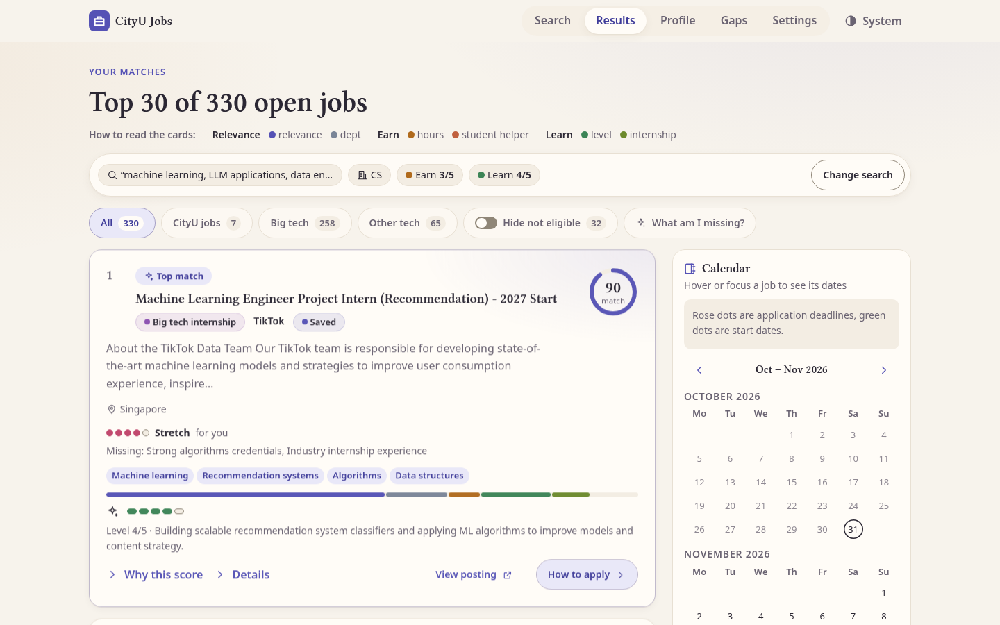
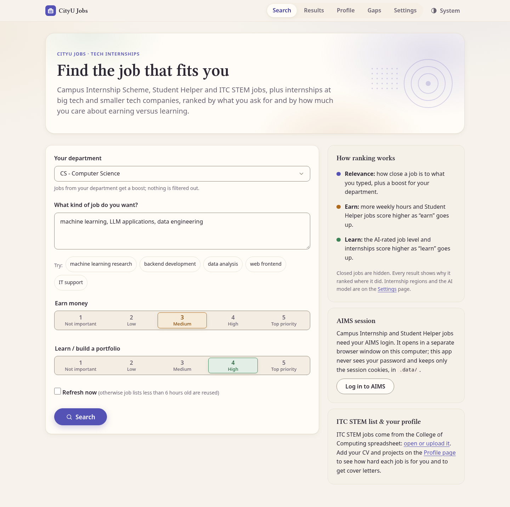
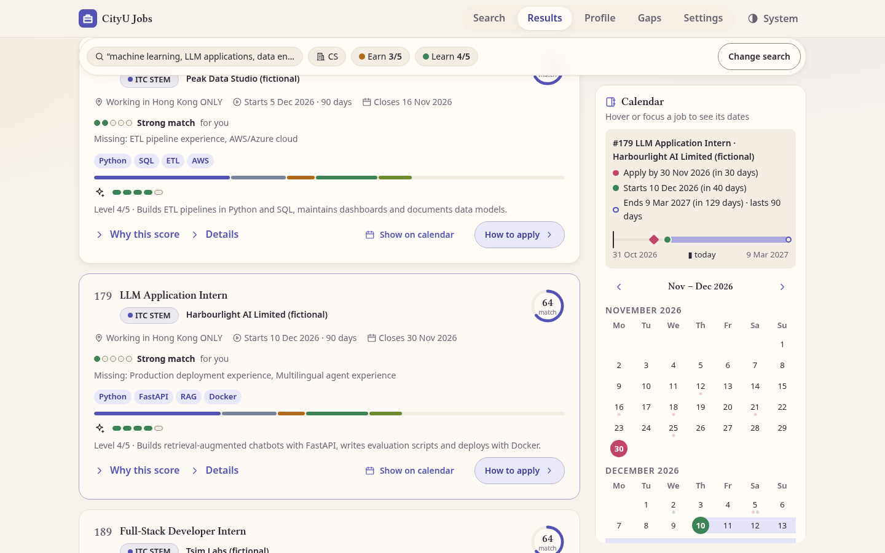
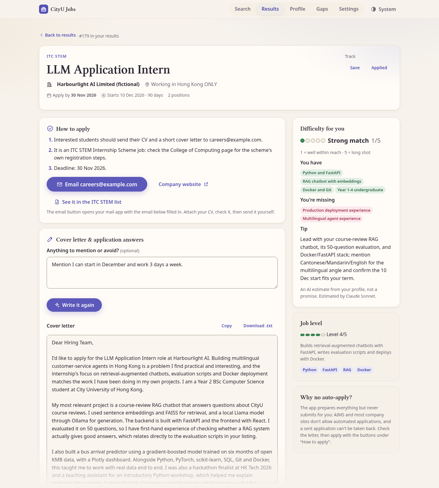
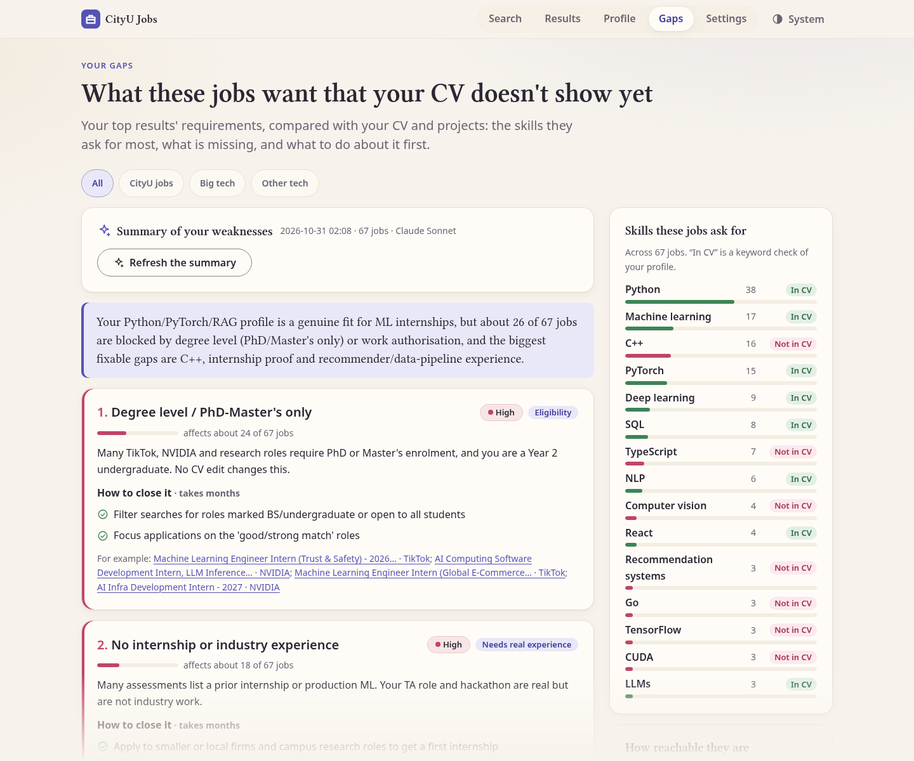
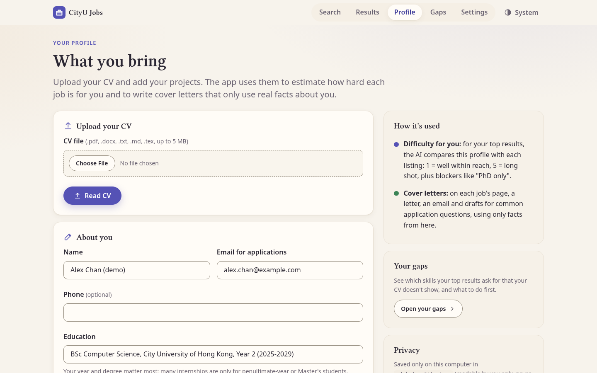
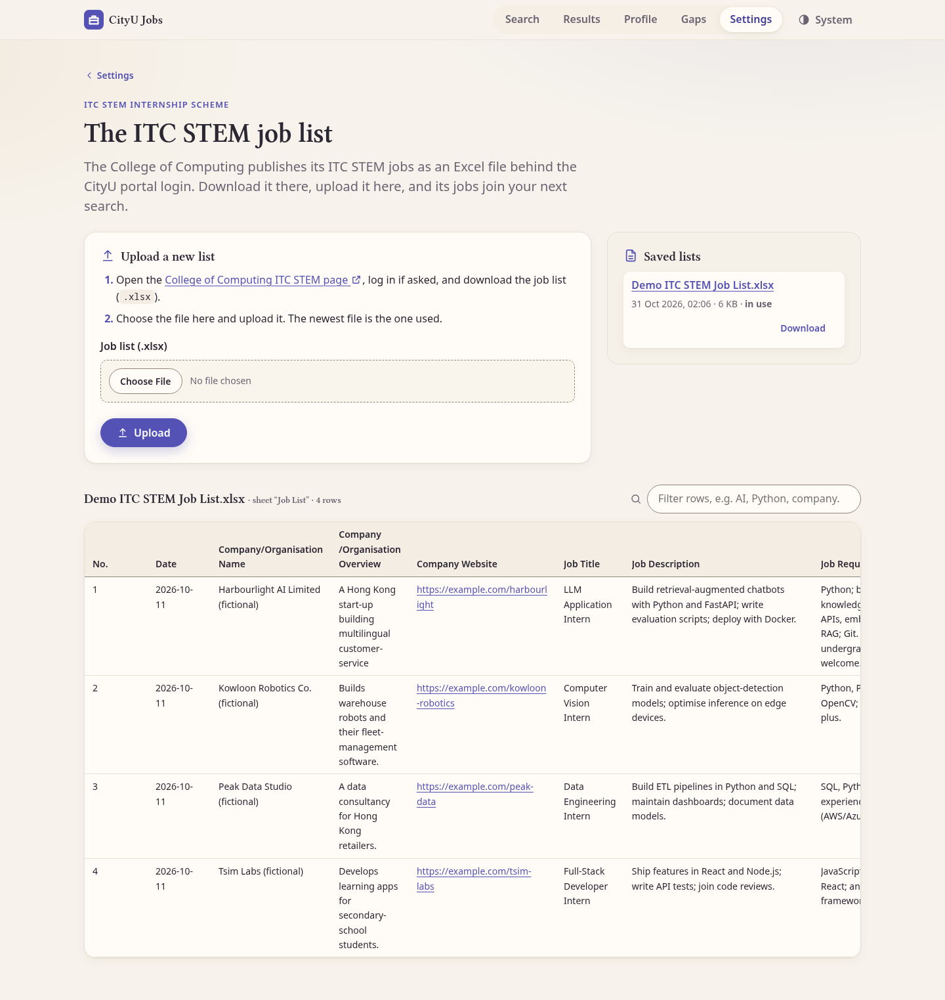
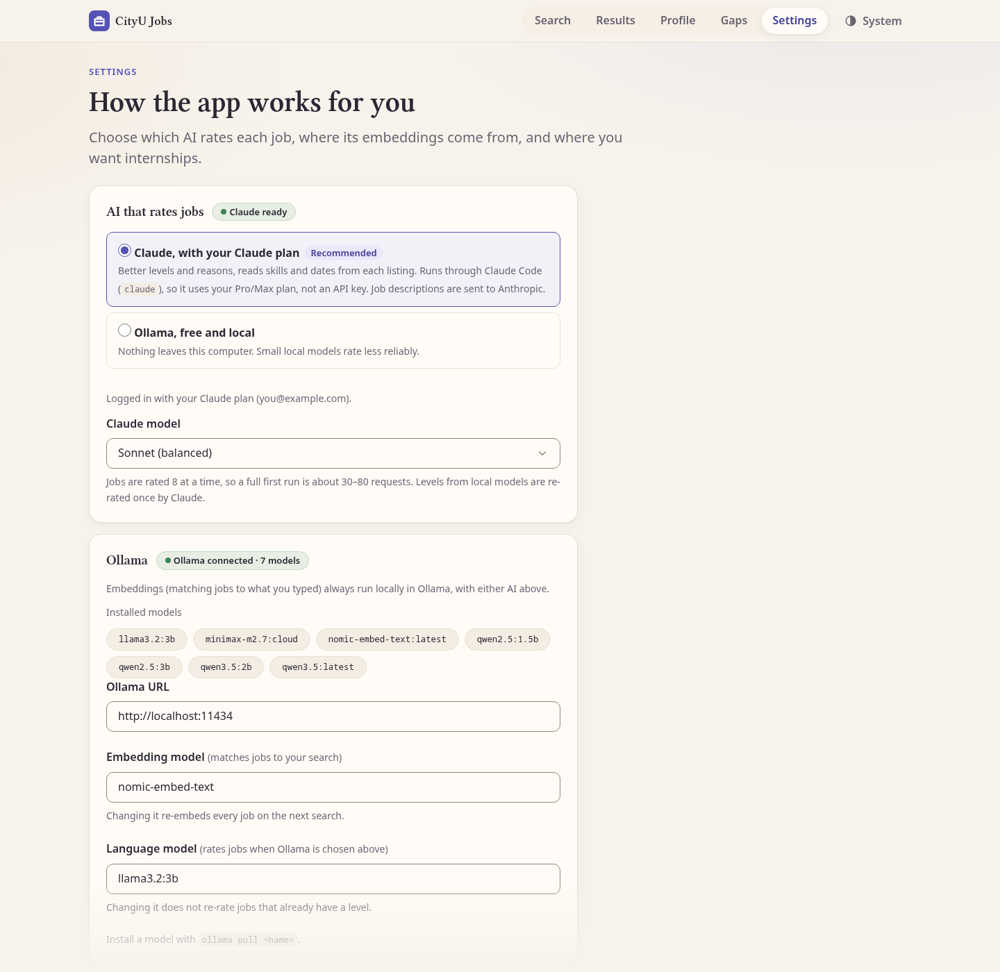
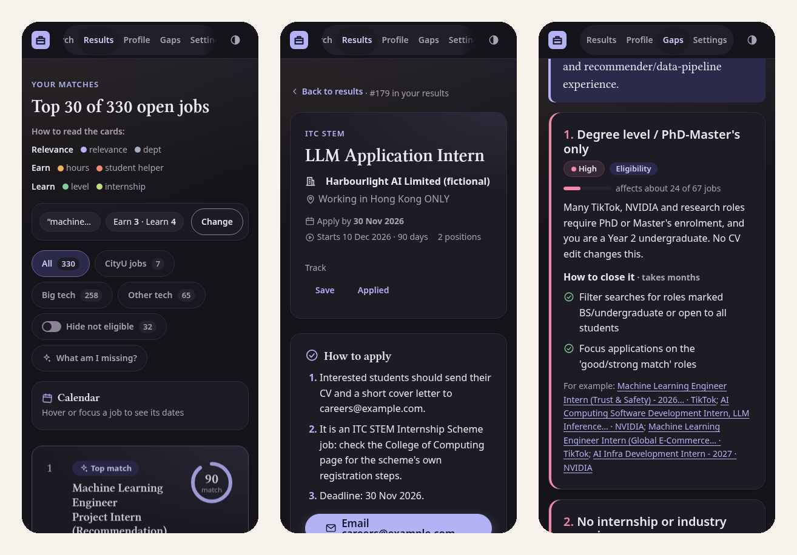
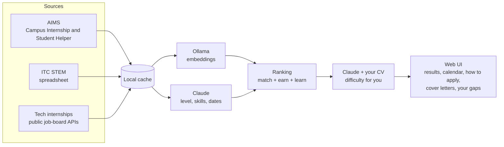

# CityU Job Recommender

A self-hosted job and internship recommender for City University of Hong Kong students.
It collects CityU's on-campus jobs and ITC STEM internships plus tech internships from
66 companies, ranks them by what you want to do and how much you care about earning
versus learning, estimates how hard each one is **for you** from your CV, and helps you
apply.


-000000)




> **About the screenshots.** They use a demo dataset: real, public internship listings plus
> *fictional* CityU jobs, a fictional ITC STEM list and a fictional student ("Alex Chan").
> Real AIMS and ITC listings sit behind the CityU login and are not published here.
> Rebuild it with [`scripts/make_demo_data.py`](scripts/make_demo_data.py).

## Features

- **One list, many sources.** Campus Internship Scheme and Student Helper jobs (AIMS),
  ITC STEM internships (College of Computing spreadsheet), and tech internships from
  19 big tech and 47 smaller tech, AI, fintech and quant companies, plus the SimplifyJobs list.
- **Ranking you can read.** Semantic match to your description, a department boost, and
  your earn/learn priorities, combined into a 0–100 score with a per-part breakdown.
- **AI job analysis.** Claude rates each job's level (1–5), lists the skills it asks for,
  and reads start dates, durations and deadlines out of the text.
- **Calendar.** Deadlines, start dates and durations; hover a job to see its timeline.
- **How to apply, in full.** Employer, application steps, contact or email, and every
  field of the listing, with Saved/Applied tracking.
- **Difficulty for you.** Upload your CV: each top result gets a 1–5 difficulty, a verdict,
  hard blockers ("PhD students only"), what you have, what's missing, and a tip.
- **Cover letters.** A tailored letter, application email and form-answer drafts that use
  only facts from your profile. Nothing is ever sent for you.
- **Your gaps.** The skills your target jobs want that your CV doesn't show, ranked by how
  many jobs they cost you, with concrete fixes and a short plan.
- **Private by design.** Runs on `127.0.0.1`; your AIMS password never reaches the app;
  embeddings run locally; personal files are git-ignored and readable only by you.

## Tour

### Search

Describe the work you want, pick your department, and set how much earning money and
learning matter (1–5 each).



### Results and calendar

Each card shows the match score and what it is made of, the AI-rated level and skills,
and **difficulty for you**. Tabs split CityU jobs, big tech and other tech; *Hide not
eligible* removes jobs you can't apply for yet. Hover or pin a job to see its deadline,
start and duration on the calendar.



### Job page: how to apply, difficulty and cover letter

Everything needed to apply in one place: the employer, the application steps (here, an
ITC STEM job that asks for a CV by email, with a pre-filled email button), the full
listing, and the difficulty estimate with what you have and what is missing. *Write my
cover letter* produces a letter, an email and answer drafts you can edit, copy or download.



### Your gaps

The right column is computed by code: the skills your top results ask for most and
whether your CV shows them. The summary on the left is one Claude request over that
evidence: weaknesses ranked by impact, each with fixes, effort and example jobs.



### Profile

Upload a CV (PDF, Word, LaTeX, Markdown or text) and add projects and skills. Only the
extracted text is kept, and you can edit it.



<details>
<summary><strong>More screenshots: ITC STEM list, settings, mobile and dark mode</strong></summary>

#### ITC STEM job list

Upload the College of Computing spreadsheet, browse it as a filterable table, and download
saved lists. A job's page links straight to its row.



#### Settings

Choose Claude (default, through your Claude plan) or a local Ollama model, the embedding
model, and the regions to fetch internships for.



#### Mobile and dark mode



</details>

## How it works



1. **Collect.** Playwright reads AIMS in your logged-in session (read-only, 1.5 s between
   pages); openpyxl reads the ITC STEM spreadsheet; httpx calls public job-board APIs
   (Greenhouse, Lever, Ashby, SmartRecruiters, Workday, Amazon, Microsoft, TikTok).
   Everything is cached and re-fetched only after 6 hours.
2. **Analyse.** Claude rates new or changed listings in batches: level, reason, skills and
   dates, returned as validated JSON.
3. **Match and rank.** Ollama embeds your description and each job locally; the score
   combines similarity, department, hours and level, weighted by your priorities.
4. **Personalise.** With a profile, Claude estimates difficulty for your top results;
   letters and the gaps summary build on the same data.

More detail: [docs/how-it-works.md](docs/how-it-works.md) (a guided tour of each stage),
[docs/data-model.md](docs/data-model.md) and [architecture.md](architecture.md) (design
decisions and their reasons).

## Getting started

**Requirements**

- Python 3.11+ and [uv](https://docs.astral.sh/uv/)
- [Ollama](https://ollama.com), running at `http://localhost:11434`, for embeddings
- For the default AI: [Claude Code](https://claude.com/claude-code) logged in with a
  Claude plan (Pro/Max). Run `claude` once and log in; `claude auth status` should show
  `"authMethod": "claude.ai"`. No API key is used. Prefer fully local? Choose Ollama in Settings.

**Install**

```sh
git clone https://github.com/nurasik14/CityUHK_job_scraper.git
cd CityUHK_job_scraper
uv sync                              # Python dependencies into .venv/
uv run playwright install chromium   # browser for the AIMS scraper (one time)
ollama pull nomic-embed-text         # embedding model (required)
ollama pull llama3.2:3b              # only if you choose Ollama instead of Claude
```

**Run**

```sh
uv run uvicorn cityu_jobs.web.app:app --reload
```

Open <http://127.0.0.1:8000>, then:

1. **Profile**: upload your CV and add your year of study and projects (optional, but
   needed for difficulty estimates, letters and gaps).
2. **Settings → ITC STEM list**: upload the College of Computing job list (optional).
3. **Search**: describe what you want and click *Search*. Click *Log in to AIMS* when
   asked to include CityU on-campus jobs.

The first search fetches and rates everything (internships take 2–3 minutes; a full AIMS
scrape about 35 minutes the first time); later searches take seconds. The
[user guide](docs/user-guide.md) covers every page in detail.

**Try it with demo data** (no CityU login needed):

```sh
uv run python scripts/make_demo_data.py /tmp/cityu-demo   # needs one earlier search for the internships
CITYU_JOBS_DATA_DIR=/tmp/cityu-demo uv run uvicorn cityu_jobs.web.app:app --port 8765
```

## Privacy and data

| What | Where | Who sees it |
|---|---|---|
| AIMS password | typed only into the real CityU login page | never the app |
| AIMS session cookies | `.data/aims_session.json` (mode 600) | only you; delete to log out |
| Jobs, AI ratings, embeddings | `.data/cache.json` | local |
| Job descriptions | sent to Anthropic for rating | Anthropic, when Claude is selected |
| Your search text | embedded locally by Ollama | local only |
| CV text and profile | `.data/profile.json` (mode 600) | Anthropic, when estimating difficulty, writing letters or gaps |
| Letters, tracking, gaps | `.data/letters/`, `applications.json`, `gaps.json` | local |

- The whole `.data/` folder is git-ignored. With **Ollama** selected, nothing leaves your
  computer (difficulty estimates and the gaps summary then need Claude and are skipped).
- The app listens on `127.0.0.1` only and refuses form posts from other websites.
- If `ANTHROPIC_API_KEY` is set, it is removed before starting `claude`, so usage always
  goes through your plan, never per-request billing.

## Responsible use

- **Read-only.** The AIMS scraper only searches and opens job descriptions, slowly; it
  never touches an apply form. Internship data comes from public APIs that the companies'
  own careers pages use. Sites whose terms forbid scraping (JobsDB, CTgoodjobs, LinkedIn)
  are not used.
- **No automatic applications.** The app prepares letters and emails; you review and send them.
- **AI output is advice.** Levels, difficulty estimates, letters and gaps can be wrong.
  Letters are instructed to use only facts from your profile, but always read them.
- Whether CityU's rules allow automated access to AIMS is not confirmed; using it is your call.

## Project structure

```
src/cityu_jobs/
├── config.py                settings and constants
├── core/                    all logic, no web code
│   ├── pipeline.py          search = refresh sources + recommend
│   ├── aims_scraper.py      AIMS listings (Playwright, read-only)
│   ├── itc_stem_scraper.py  ITC STEM spreadsheet
│   ├── internships/         job-board catalogue, fetchers, region filter
│   ├── analysis.py          AI level, skills and dates per job
│   ├── embeddings.py        Ollama vectors and similarity
│   ├── ranking.py           match score and its breakdown
│   ├── dates.py             timelines for the calendar
│   ├── apply_info.py        employer and how to apply
│   ├── profile.py           profile storage, CV text extraction
│   ├── fit.py               difficulty for you
│   ├── letters.py           cover letters, Saved/Applied tracker
│   ├── gaps.py              weakness summary
│   └── ai/providers.py      Claude CLI, Ollama, test fakes
└── web/                     FastAPI routes, Jinja templates, CSS and JS (no build step)
scripts/                     AIMS login and scrape helpers, demo data builder
tests/                       325 offline tests
docs/                        user guide, how it works, data model, screenshots
```

## Development

```sh
uv run pytest
```

The tests run fully offline: no AIMS login, no network, no `claude` process and no Ollama
(fakes stand in for the browser, the job boards and the AI; a test that tries the network
fails). Tests that use saved AIMS pages in `.data/fixtures/` are skipped when those pages
are absent, since they contain personal data.

**Stack:** Python, FastAPI, Jinja2, uvicorn, Playwright, BeautifulSoup, openpyxl, httpx,
pypdf, the Claude Code CLI and Ollama. The front end is plain HTML, CSS and a small
JavaScript file, with light and dark themes and keyboard and screen-reader support.
